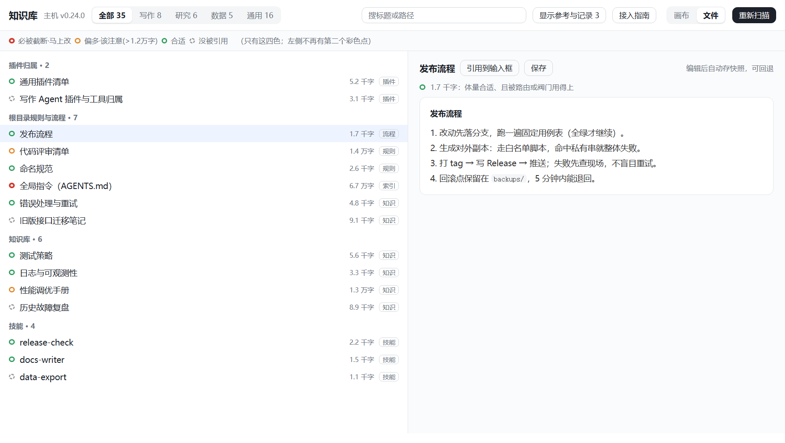
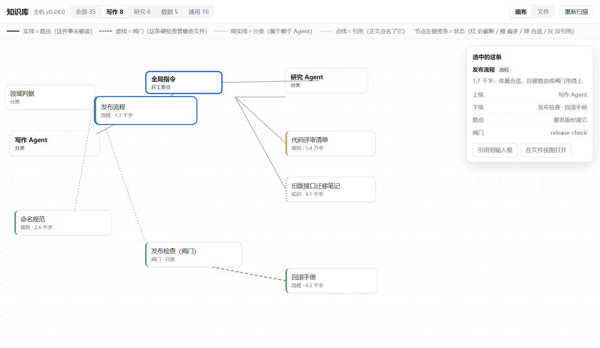

# dsh-knowledge-base

> **For people who keep their AI rules in Markdown files and lose track of them.**
> A panel for **DeepSeek Harness (DSH)** that indexes the rules, knowledge, skills and plugin lists you already have on disk — across several agents — shows them as a list and as a focusable canvas, and edits those **original files in place**. No copies, no import step.

[](LICENSE)
[](https://github.com/1306693274/dsh-knowledge-base/releases)
[](package.json)

**Keywords**: knowledge base · rules management · prompt / context management · markdown docs · multiple agents · DSH plugin · local-first

**Install** (DSH → Plugins → Add plugin → pick this folder), then open **知识库 / Knowledge base** in the left sidebar. Configuration is one JSON file — see [Configuration](#configuration-the-only-thing-you-must-do).

[中文说明见下方](#中文).

---



<sub>Screenshot rendered with **demo data** — invented file names, not anyone's real rules.</sub>



<sub>The canvas focuses on one item: upstream on the left, downstream on the right, downstream-of-downstream included.</sub>

---

## Who this is for

- You keep rules as Markdown (`AGENTS.md`, per-agent rule folders, skills, checklists) and **have stopped keeping track** of what exists.
- You run **more than one agent** and need to know which document belongs to which one.
- You have documents that are **too long to be read reliably** and want the ones to trim surfaced, not guessed.
- You want edits to change the **real files**, not a copy that drifts.

If your knowledge lives in a database or a SaaS wiki, this plugin is not that — it is deliberately file-first.

## Why this exists

If you run more than one agent on a machine (say a writing agent, a research agent and a data agent), your real knowledge base ends up scattered: one global instruction file, per-agent rule folders, skill folders, plugin lists, and a routing table pointing at all of them.

You can no longer answer three questions by looking at the filesystem:

1. **What do I actually have?** Which of these 400 markdown files are rules, which are evidence, which are dead?
2. **Which agent does this belong to?** And who is *above* it, what is *below* it?
3. **Which of them is too big to be read reliably?** (Long-context models degrade on very long inputs, and some limits are hard truncation.)

This plugin answers all three inside DSH, without copying anything.

## Features

| | |
|---|---|
| **Real files, no copies** | The panel reads the files on disk and writes back to the same paths. Library folder only holds index cache, edit history, canvas layout, per-file overrides. |
| **Configurable categories** | Ships five example categories and assigns every document by **name-based domain inference** (not a keyword dump). Rename them, or add your own agents as more categories, in one config file. |
| **Canvas with focus** | Every file is a node. Selecting one shows **upstream → this → downstream** (and downstream of downstream). Lines are typed: route / valve / category / reference / plugin. |
| **Size & status rings** | 🔴 will be truncated (hard limit) · 🟠 long, worth trimming · 🟢 fine · ⚪ never referenced. Thresholds and rationale below. |
| **Plugin ownership** | A "which plugin belongs to which agent" document is parsed into plugin nodes you can click to read what the plugin does. |
| **Right-click → reference into a chat** | Right-click any item to drop `@"<absolute path>"` into the composer of a conversation, then type your request. |
| **Two-hop routing** | A `rules` table in `AGENTS.md` decides the domain; each domain file points at the actual document. Rendered as lines on the canvas. |
| **In-place editing** | Edit in the side panel, save, and every write is snapshotted first (restorable). Route-table edits are verified by read-back and rolled back on mismatch. |

## Install

```bash
# from the plugin folder (linked install)
plugin_manager install_bundle  →  or: DSH → Plugins → Add plugin → pick this folder
```

After installing, open **知识库 / Knowledge base** in the left sidebar. If the list is empty, read the next section — it is a configuration problem, never a crash.

## Configuration (the only thing you must do)

The plugin scans what you tell it to scan. Put a `知识库.json` in `~/.dsh/知识库/`:

```json
{
  "roots": { "dsh": "C:\\Users\\you\\.dsh", "pkg": "E:\\notes", "work": "E:\\workspace" },
  "sources": [
    { "cat": "general", "group": "全局指令", "root": "dsh", "path": "AGENTS.md" },
    { "cat": "general", "group": "全局技能", "root": "dsh", "path": "skills", "dir": true, "only": "SKILL.md" },
    { "cat": "design",  "group": "规则", "root": "work", "path": "design-agent", "dirOnly": true },
    { "cat": "design",  "group": "技能", "root": "work", "path": "design-agent/skills", "dir": true, "only": "SKILL.md" }
  ]
}
```

Field reference: `cat` · `root` (`dsh` / `pkg` / `work`) · `path` or `paths` · `dir` (recurse) · `dirOnly` (top level only) · `only` (single filename, e.g. `SKILL.md`).

Resolution order for the roots: plugin config → `知识库.json` → an optional path table in `~/.dsh/` → built-in default.
Nothing configured? It still runs with a minimal default and prints which root is missing instead of showing a blank screen.

**For AI agents**: [`docs/AI-接入指南.md`](docs/AI-接入指南.md) is written *for an agent to execute* — field semantics, the exact table header a route table must contain, the section titles a plugin-ownership document must use, a failure lookup table, and a completion checklist. It is also served live at `GET /plugins/dsh-knowledge-base/guide`.

## Status rings and the numbers behind them

| Ring | Condition | Why |
|---|---|---|
| 🔴 hard | `AGENTS.md` > 65,536 bytes · or a `SKILL.md` `description` > 500 chars | Hard truncation: the overflow is silently cut, so the model never sees it. 100% broken, not a matter of attention. |
| 🟠 heavy | > 12,000 characters | Soft degradation: accuracy drops as input grows, and mid-context material is used less ("lost in the middle", "context rot"). A reminder line, not a law. |
| ⚪ unused | not reachable from any route, valve, or other document | Nothing reads it today. |
| 🟢 ok | everything else | |

The 12,000 threshold is an **opinionated default**, not a technical limit; the 65,536 / 500 ones come from DSH itself and are real truncation points.

## Requirements

- DeepSeek Harness desktop with plugin support (`webServer` service available).
- Node.js 20+ (no runtime dependencies — the package ships plain ESM and an ESM client bundle).

## Self-checks

```bash
node tools/check-bundle.mjs     # manifest / BOM / patch row / icon / syntax / version sync
node tools/test-portable.mjs    # a foreign machine: config-driven roots, no route table, missing path → warnings
```

Both use temporary directories and touch no user data.

## What this plugin deliberately does not do

- **Copy content.** It indexes and edits; the library folder holds no knowledge.
- **Own your sync.** Whatever syncs your files keeps doing it.
- **Install or remove plugins.** It only records which agent *owns* which plugin; management still belongs to DSH.

## Images

`docs/images/*.png` are rendered from the demo pages next to them (`docs/images/demo-*.html`) with **invented content**, so the screenshots show the layout without exposing anyone's real knowledge base. Regenerate:

```bash
msedge --headless=new --window-size=1240,720 --force-device-scale-factor=1.5 \
  --screenshot=docs/images/canvas.png docs/images/demo-canvas.html
```

## License

MIT — see [LICENSE](LICENSE).

---

<a id="中文"></a>
## 中文

**适合谁**：规则/知识就以 Markdown 存在本机、并且已经理不清有哪些、哪条属于哪个 Agent、哪些长得读不全的人。

**这是什么**：一个挂在 DSH 左栏的「知识库」面板。把你机器上**已经存在**的规则、知识、技能、插件清单、路由表汇总成一个列表 + 一张无限画布，并且**就地改原文件**——不复制、不导入。

**界面长这样**（示例数据，不是任何人的真实规则）：


**为什么需要它**：一台机器上跑好几个 Agent 时，真正的知识库散在好几十个目录里：全局指令、每个 Agent 的规则目录、技能目录、插件清单、路由表。光看文件系统已经回答不了三个问题——我到底有哪些？这条属于哪个 Agent、它的上级和下级是谁？哪几份已经大到模型读不全？

**能干什么**：

- 五类归属（通用 / 设计 / 动态 / 助手 / 金融），分类可配置，加新 Agent 只改配置
- 画布聚焦：选中一条，看得到 **上级 → 它 → 下级**（下级还有下级也会展开）
- 四色状态圈：🔴 必被截断 / 🟠 偏长该精简 / 🟢 合适 / ⚪ 没被引用
- 插件归属：从「哪个 Agent 独占哪些插件」的文档里解析出插件节点，点开看它干什么
- 右键引用：把 `@"绝对路径"` 直接放进对话输入框，接着写要求
- 两跳路由：`AGENTS.md` 里先判领域，再跳到该领域的路由文件，画布上画成线
- 就地编辑 + 历史快照：改坏了能退；改路由表会回读校验，不一致自动回滚

**装完要做的唯一一件事**：在 `~/.dsh/知识库/知识库.json` 里告诉它扫哪些目录（字段见上面的英文节）。没配也能跑，会用一份最小默认并在界面顶部提示哪个根没接上，不会白屏。

**给 AI 的一张说明**：[`docs/AI-接入指南.md`](docs/AI-接入指南.md) 是写给 AI 照着做的（字段语义、路由表表头必须含哪几个字、插件归属文档的小节标题要求、失败对照表、完工清单），也可以直接 `GET /plugins/dsh-knowledge-base/guide` 取。